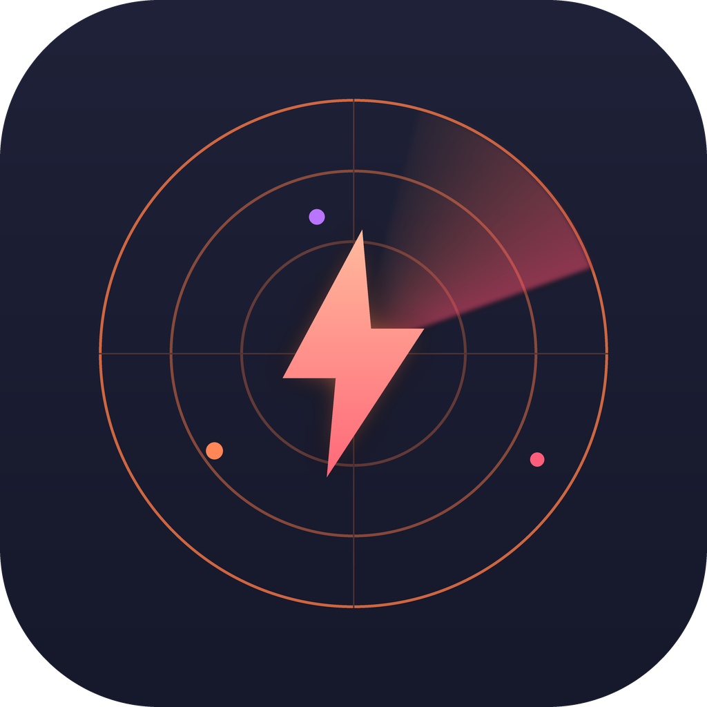
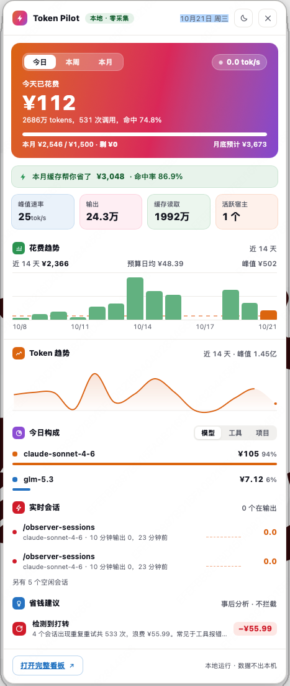

<div align="center">



# token-pilot ⚡

### Local billing for all your AI tools, always one glance away

For anyone running Claude Code / Codex / Kimi Code with Chinese models (DeepSeek, GLM…) and can't answer "how much did I burn on AI this month" — reads local logs only, nothing leaves your machine.

[](LICENSE)
[](#-menubar-app)
[](tests/)
[](#-data-accuracy)

[Quickstart](#-quickstart) · [Menubar App](#-menubar-app) · [Data Accuracy](#-data-accuracy) · [When NOT to use](#-when-not-to-use-it) · [中文](README.md) · [llms.txt](llms.txt)

</div>

---



> Lives in your menubar as `⚡ ¥today · budget%`. Left-click for the panel, "Open dashboard" for the full picture. My real October: **810M tokens · ¥2,546 · 12,685 calls** ([how we know](#-data-accuracy)).

> ⚠️ npm 上另有一个**别人家的** `token-pilot`（MCP 代码导航工具，会往 Claude Code 写 hooks）。我们的包是 **`@anthonyhan/token-pilot`**，下面命令都带 scope，照抄即可。

## 🚀 Quickstart

**For Humans:**

```bash
npm install -g @anthonyhan/token-pilot
token-pilot month     # month bill + forecast + retry-loop detection + savings advice
```

**For AI Agents:** (paste this to your agent)

> Install token-pilot for me: `npm install -g @anthonyhan/token-pilot`, then run `token-pilot month` and tell me how much I spent on AI this month and where I'm wasting it.

### Menubar App

After install it lives **only in the menubar** — no Dock icon, no startup window. Left-click opens the panel, right-click the menu.

**macOS (Apple Silicon / Intel)**:

```bash
# Option 1: Homebrew (recommended — handles Gatekeeper for you)
brew install --cask anthonyhann/token-pilot/token-pilot
```

```bash
# Option 2: grab the .dmg from Releases, drag to Applications, then once (fixes the unsigned "damaged" dialog):
xattr -dr com.apple.quarantine /Applications/token-pilot.app
```

**Windows**: grab the `.msi`, SmartScreen → "Run anyway".

Build it yourself: `cd menubar && npm install && npx tauri build`

## ✨ What it does

| You want | You say | It does |
|---|---|---|
| The bill | `token-pilot month` | Per-host & per-model month bill + month-end forecast |
| Budget guardrails | set a monthly budget | progress bar + system notification + menubar `¥today · budget%` |
| Catch runaway agents | nothing | flags sessions with ≥30 calls stuck in retry loops, computes the waste |
| Save money | see "savings" cards | expensive-model-for-light-tasks migration advice with $/month saved; low cache-hit sessions; how much cache saved you this month |
| Who's burning | see host/model/project ranks | which tool, which model, which project costs most |
| Chinese models | nothing to configure | DeepSeek/GLM/Kimi/Qwen auto-normalized via host-log `model` field |

**Works with your toolchain:** Claude Code ✅ · Codex ✅ · Kimi Code ✅ · OpenCode ✅ · pi ✅ · DeepSeek Harness ✅ · WorkBuddy ✅ · Doubao cloud ✅ · DeepSeek/GLM/Kimi/Qwen/MiniMax/Hunyuan/MiMo/LongCat/Doubao ✅ (model normalization) · 12 more detected-only · desktop subscription apps tracked as fixed monthly fees

## 📈 Data accuracy

A billing tool that's wrong is worse than none. Accuracy here is **verifiable**:

```bash
python3 scripts/reconcile.py month    # independent third-party recount of raw logs vs CLI
python3 scripts/verify-dashboard.py   # 36 dashboard algorithm invariants
npm test                              # 23 unit tests (pricing / collection / aggregation)
```

Real accounting bugs fixed (2026-10-21, 4,787 log files on my machine):

| Bug | Impact | Fix |
|---|---|---|
| Claude streaming snapshot duplicates | one session: 169 usage lines = 79 actual calls | dedupe by `message.id`, keep max |
| Codex `input` includes `cached` subset | cache billed at full price AND cache price | split `input − cached` |
| Kimi `inputOther` is the real fresh input | same double-billing | only `usage.record`, no cache merging |

## 📊 Why trust me

- It runs my own AI bill: **¥2,546 / 810M tokens** this month (2026-10-21, screenshots above are my live data)
- 36 dashboard invariants + 23 unit tests + an independent reconciliation script — all runnable out of the box
- Honest about rate accounting: logs book tokens at call-completion time; in-flight generations aren't counted until they finish (noted in the dashboard)

## ⚠️ When NOT to use it

- **Your tool doesn't write local usage logs** (Antigravity / Copilot / Cursor and 9 more) — we detect presence, but there's no token data to read
- **Desktop subscription apps** (Kimi.app / ChatGPT.app) — not per-token billed; tracked as fixed monthly fees only
- **You want to throttle requests before they happen** — it's after-the-fact analysis, not a proxy (a routing layer is on the roadmap)

## 💰 Support

Free & MIT. If it saved you money on AI bills, buy me a coffee (Alipay / WeChat codes in the [Chinese README](README.md#-支持这个项目)) — or just say hi on [X @AnthonyHan_](https://x.com/AnthonyHan_).

⭐ Star = vote for your host: the next adapter gets built for the most-nominated tool.

## 🙋 About me

A solo dev + a few AI agents running product experiments (remote, Xi'an). token-pilot is what I actually use daily — it first caught a kimi-code session stuck in a 120-call retry loop, then told me caching saved me ¥3,048 this month.

## 📝 Changelog

- **2026-10-21** v0.1.0: first release — CLI bill + local dashboard + macOS/Windows menubar app

## ✅ TODO

**Coverage**
- [x] OpenCode adapter (SQLite) · Qoder (session counts) · pi · Cursor spike
- [x] Cloud usage API: Doubao Volcano (arkcli, daily granularity)
- [ ] Cloud usage APIs: OpenAI / Moonshot (user-provided API key)

**Throttling (step 2)**
- [x] 2A Compression potential measurement
- [x] 2B layer 1: auto-compact alerts + Claude autoCompact + one-click RTK install
- [ ] 2B layer 2: proxy gateway (LiteLLM/self-built)
- [ ] 2B Compression execution (integrate Gobstopper-style proxy first)
- [ ] Cheap-model routing (optional local proxy — never touches your config by default)
- [ ] Proactive retry-loop breaker notifications

**Platform & engineering**
- [x] macOS menubar app (arm64 .app/.dmg)
- [x] Windows audit + platform icons + CI
- [ ] Windows .msi on-device validation (Actions artifact)
- [ ] Intel Mac build (universal2) · auto-update (tauri-updater) · signing & notarization

## License

MIT © anthonyhann
