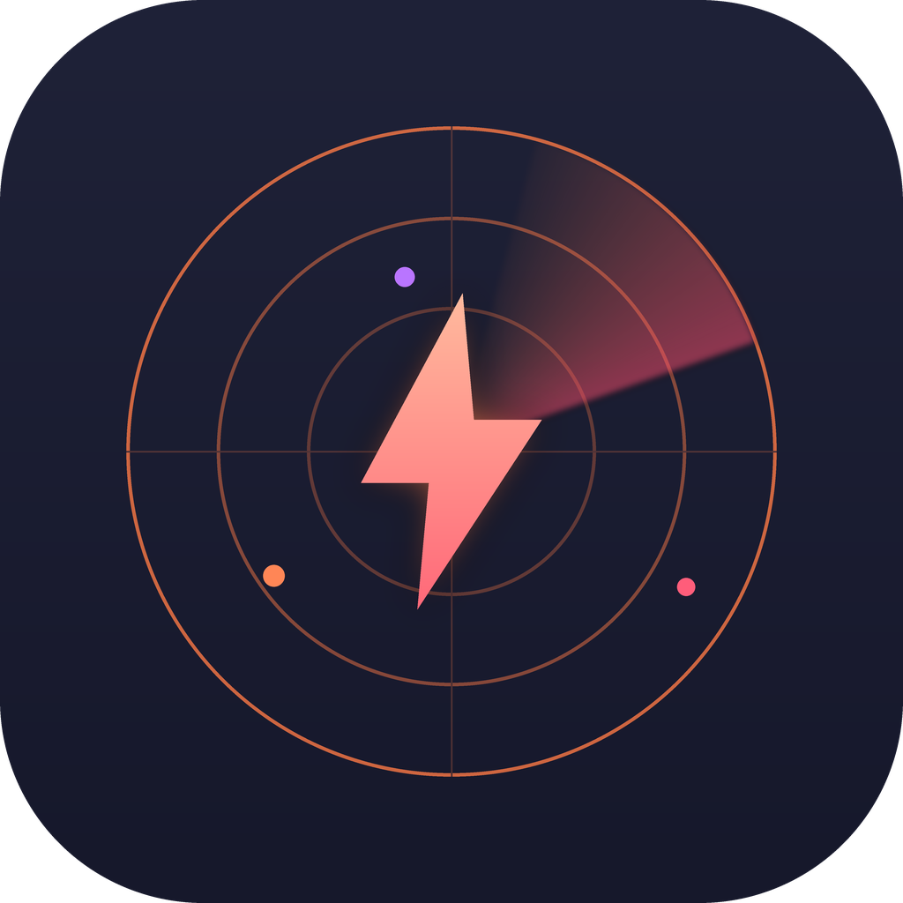
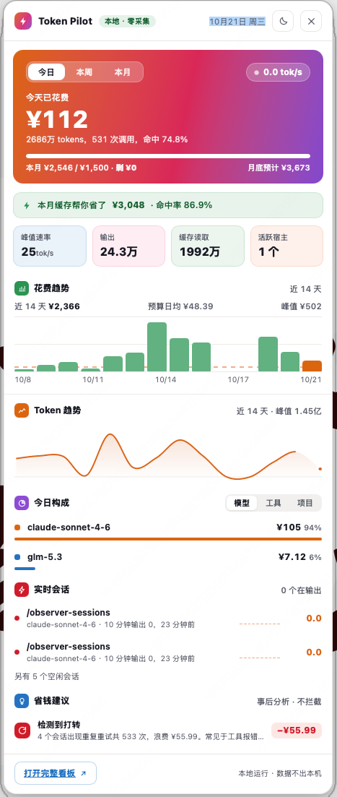

<div align="center">



# token-pilot ⚡

### Local billing for all your AI tools, always one glance away

For anyone running Claude Code / Codex / Kimi Code with Chinese models (DeepSeek, GLM…) and can't answer "how much did I burn on AI this month" — reads local logs only, nothing leaves your machine.

[](LICENSE)
[](#-menubar-app)
[](tests/)
[](#-data-accuracy)

[Quickstart](#-quickstart) · [Menubar App](#-menubar-app) · [Data Accuracy](#-data-accuracy) · [When NOT to use](#-when-not-to-use-it) · [中文](README.md) · [llms.txt](llms.txt)

</div>

---



> Lives in your menubar as `⚡ ¥today · budget%`. Left-click for the panel, "Open dashboard" for the full picture. My real October: **4.78B tokens · ¥8,265 · 32,643 calls** ([how we know](#-data-accuracy)).

> ⚠️ npm 上另有一个**别人家的** `token-pilot`（MCP 代码导航工具，会往 Claude Code 写 hooks）。我们的包是 **`@anthonyhan/token-pilot`**，下面命令都带 scope，照抄即可。

## 🚀 Quickstart

**For Humans:**

```bash
npm install -g @anthonyhan/token-pilot
token-pilot month     # month bill + forecast + retry-loop detection + savings advice
```

**For AI Agents:** (paste this to your agent)

> Install token-pilot for me: `npm install -g @anthonyhan/token-pilot`, then run `token-pilot month` and tell me how much I spent on AI this month and where I'm wasting it.

### Menubar App

After install it lives **only in the menubar** — no Dock icon, no startup window. Left-click opens the panel, right-click the menu.

**macOS (Apple Silicon / Intel)**:

```bash
# Option 1: Homebrew (recommended — handles Gatekeeper for you)
brew install --cask anthonyhann/token-pilot/token-pilot
```

```bash
# Option 2: grab the .dmg from Releases, drag to Applications, then once (fixes the unsigned "damaged" dialog):
xattr -dr com.apple.quarantine /Applications/token-pilot.app
```

**Windows**: grab the `.msi`, SmartScreen → "Run anyway".

Build it yourself: `cd menubar && npm install && npx tauri build`

## ✨ What it does

| You want | You say | It does |
|---|---|---|
| The bill | `token-pilot month` | Per-host & per-model month bill + month-end forecast |
| Budget guardrails | set a monthly budget | progress bar + system notification + menubar `¥today · budget%` |
| Catch runaway agents | nothing | flags sessions with ≥30 calls stuck in retry loops, computes the waste |
| Save money | see "savings" cards | expensive-model-for-light-tasks migration advice with $/month saved; low cache-hit sessions; how much cache saved you this month |
| Who's burning | see host/model/project ranks | which tool, which model, which project costs most |
| Chinese models | nothing to configure | DeepSeek/GLM/Kimi/Qwen auto-normalized via host-log `model` field |

**Works with your toolchain:** Claude Code ✅ · Codex ✅ · Kimi Code ✅ · OpenCode ✅ · pi ✅ · DeepSeek Harness ✅ · WorkBuddy ✅ · Doubao cloud ✅ · DeepSeek/GLM/Kimi/Qwen/MiniMax/Hunyuan/MiMo/LongCat/Doubao ✅ (model normalization) · 12 more detected-only · desktop subscription apps tracked as fixed monthly fees

## 📈 Data accuracy

A billing tool that's wrong is worse than none. Accuracy here is **verifiable**:

```bash
python3 scripts/reconcile.py month    # independent third-party recount of raw logs vs CLI
python3 scripts/verify-dashboard.py   # 36 dashboard algorithm invariants
npm test                              # 69 unit tests (pricing / collection / aggregation / breaker / RTK / quota / concurrency)
```

Real accounting bugs fixed (2026-10-21, 4,787 log files on my machine):

| Bug | Impact | Fix |
|---|---|---|
| Claude streaming snapshot duplicates | one session: 169 usage lines = 79 actual calls | dedupe by `message.id`, keep max |
| Codex `input` includes `cached` subset | cache billed at full price AND cache price | split `input − cached` |
| Kimi `inputOther` is the real fresh input | same double-billing | only `usage.record`, no cache merging |

## 📊 Why trust me

- It runs my own AI bill: **¥8,265 / 4.78B tokens** this month (2026-10-29, screenshots above are my live data)
- 36 dashboard invariants + 69 unit tests + an independent reconciliation script — all runnable out of the box
- Honest about rate accounting: logs book tokens at call-completion time; in-flight generations aren't counted until they finish (noted in the dashboard)

## ⚠️ When NOT to use it

- **Your tool doesn't write local usage logs** (Antigravity / Copilot / Cursor and 9 more) — we detect presence, but there's no token data to read
- **Desktop subscription apps** (Kimi.app / ChatGPT.app) — not per-token billed; tracked as fixed monthly fees only
- **You want to throttle requests before they happen** — it's after-the-fact analysis, not a proxy (a routing layer is on the roadmap)

## 🔋 Subscription quotas & balances

Billing answers "how much did I spend"; quotas answer "how much is left". The latter comes straight from each provider's own endpoint, not from local estimation.

| Provider | What you get | Source |
|---|---|---|
| **OpenCode Go** | rolling / weekly / monthly usage percent | Official API, reuses OpenCode's own login |
| **Volcengine Ark** | Agent Plan absolute + percent; Coding Plan percent | Official CLI `arkcli usage plan` |
| **Zhipu GLM** | Quota windows + plan tier | Official API |
| **DeepSeek / Moonshot** | Cash balance | Official balance API |
| **MiniMax** | Remaining token plan | Official API |

**Where credentials come from** (three levels, whatever you have):

1. Keys you entered in the dashboard settings — always works
2. The platform's own stored login (e.g. `~/.local/share/opencode/auth.json`) — present if you use that tool
3. [CC Switch](https://github.com/farion1231/cc-switch) config — auto-read **only if installed**

> Level 3 is convenience, not a dependency: without CC Switch you just enter a key once and get the full quota feature set.

**Honest note**: Coding Plan tiers only return percentages, not absolute numbers. So you will never see a fabricated "used 1500/20000" — it shows exactly what the provider reports.

**Pace**: "60% used" alone is meaningless. Knowing "40% of the window elapsed but 60% consumed" tells you whether to slow down. Where a window length and reset time exist, each row is annotated "faster/slower than linear pace by N%".

## 🧩 How it differs from other tools

Cutting token spend has several distinct layers, and token-pilot only owns one of them — **the money**:

| Layer | Who handles it | Typical effect |
|---|---|---|
| **How much you spend** | **token-pilot** (this tool) | Merged bill across hosts, budget alerts, quantified waste |
| Huge command output | [RTK](https://www.rtk-ai.app/) output compressor | Built-in: install from the dashboard |
| Re-reading code | AST-based structural readers | Whole file → outline first, then read just the symbol |
| Verbose model replies | Terse-output skills | Output tokens only, no overlap with input |

**On the name collision:** there is a **different `token-pilot`** on npm ([Digital-Threads/token-pilot](https://github.com/Digital-Threads/token-pilot)) that does the "re-reading code" row above — AST-based code navigation. It does **not** track spend, and this tool does **not** read code structure. They solve different halves of the same cost problem and compose fine.

The correct package is the scoped **`@anthonyhan/token-pilot`**.

## 💰 Support

Free & MIT. If it saved you money on AI bills, buy me a coffee (Alipay / WeChat codes in the [Chinese README](README.md#-支持这个项目)) — or just say hi on [X @AnthonyHan_](https://x.com/AnthonyHan_).

⭐ Star = vote for your host: the next adapter gets built for the most-nominated tool.

## 👥 Community

- **[Discussions](https://github.com/anthonyhann/token-pilot/discussions)** — "is this model priced right?", "can you support tool X?"
- **[Issues](https://github.com/anthonyhann/token-pilot/issues/new/choose)** — wrong numbers, bugs
- **WeChat group** "让 AI 先试试 (Let AI try first)" — mostly Chinese-speaking, QR code in the [Chinese README](README.md#-开发者与交流). The QR expires; ping me on Discussions if it's dead.

Contributions welcome — writing an adapter just needs `detect()` + `collect()` in `src/adapters/`. `npm test` and `cargo test` must be green; CI runs on every push.

## 🙋 About me

A solo dev + a few AI agents running product experiments (remote, Xi'an). token-pilot is what I actually use daily — it first caught a kimi-code session stuck in a 120-call retry loop, then told me caching saved me ¥3,048 this month.

## 📝 Changelog

- **2026-10-21** v0.1.0: first release — CLI bill + local dashboard + macOS/Windows menubar app

## ✅ TODO

Legend: `[x]` done · `[ ]` planned · `[⏸]` blocked on something outside the project (reason given)

**Coverage**
- [x] OpenCode adapter (SQLite) · Qoder (session counts only, model is "auto" — labelled honestly) · pi · Cursor spike (no token usage data → detection-only)
- [x] Cloud usage API: Doubao Volcano (arkcli `usage stats`, daily granularity)
- [⏸] Cloud usage APIs: OpenAI / Kimi
  - Tested 2026-11: Kimi/Moonshot has **no public usage endpoint** — `/v1/users/me/balance` exists (401 auth), but `/v1/usage`, `/v1/users/me/usage`, `/api/v1/usage` are all 404. Balance yes, "how much did I spend today" no.
  - OpenAI does have `/v1/organization/usage/*`, but those are organization-level endpoints requiring an Organization Admin key. **I don't have one, so I can't verify whether a personal key works.** Marked blocked rather than "easy TODO".
  - Have an OpenAI admin key, or know Kimi's usage endpoint? Open a Discussion — I'll wire it up the same day it's verified.

**Throttling (step 2)**
- [x] 2A Compression potential measurement (rule engine, measured $63–95/month)
- [x] 2B layer 1: auto-compact alerts + Claude autoCompact + RTK install (backs up `settings.json`, restores on failure)
- [x] Retry-loop breaker notifications (≥30 calls in one session; max 1 alert per round so first run isn't flooded)
- [⏸] 2B layer 2: proxy gateway (LiteLLM / self-built)
  - The blocker is not engineering, it's **trust**: a local proxy takes over the request path of every AI tool you run. Before shipping it I'd need convincing answers to: how does it fail open, how do you undo it in one step, and why should anyone believe it won't touch their keys. **No middle layer that quietly rewrites your network traffic.**
- [⏸] Cheap-model routing — a sub-feature of the gateway above, and it makes one conversation switch models mid-way, which hurts coherence.

**Platform & engineering**
- [x] macOS menubar app (arm64 + Intel x64)
- [x] Windows audit + platform icons + CI (`.msi` built on Actions)
- [x] Auto-update (tauri-updater, live since v0.2.6, all three platforms share one `latest.json`)
- [x] CI release: tag → three-platform artifacts + merged `latest.json` + brew cask bump
- [⏸] Windows `.msi` on-device validation
  - CI only proves "the artifact was produced, has a signature, has a sane size". **Nobody has installed it on real Windows, launched it, or validated auto-update.** Dev machine is macOS, no Windows box available.
  - Need: a Windows 10/11 machine. Offer to test in Discussions and I'll send a checklist.
- [⏸] Universal2 single binary
  - Technically fine (all-Rust dependencies, no C libs, lipo can merge). Cost: the merged binary is necessarily larger than either per-arch dmg (currently 5.4 MB arm64 / 5.7 MB x64) — **exact size needs an actual build, this is an estimate**. `latest.json` would still ship per-arch, so it adds a merge step for little gain.
- [⏸] Code signing & notarization
  - Blocked on Apple Developer Program (**$99/year**); the project has no revenue.
  - Impact: unsigned apps get one Gatekeeper prompt on first launch (right-click open, or `xattr -dr com.apple.quarantine`). brew handles it automatically.
  - If sponsorship ever covers it, this comes first — it removes more friction for new users than any new feature.

## License

[MIT](LICENSE) © anthonyhann
