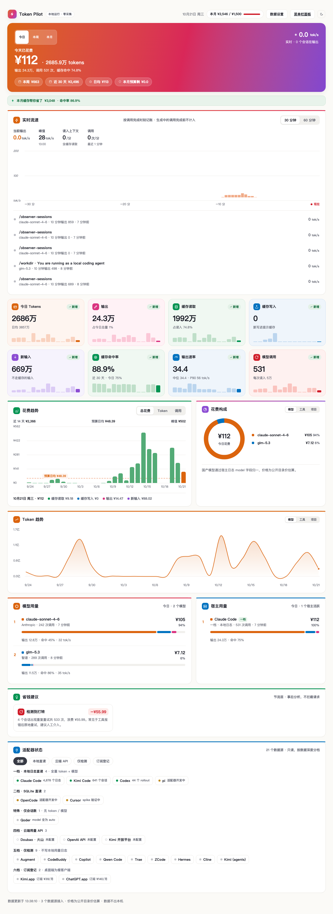

<div align="center">


# token-pilot

**你所有 AI 工具的本地账单 + 预算控制器**

只读本地日志 · 零入侵 · 数据不出本机

[](LICENSE)
[](#状态栏应用)
[](#快速开始)
[](#数据准确性)

</div>

---

我同时用 Claude Code、Codex、Kimi Code，还经常通过它们跑 DeepSeek、GLM 等国产模型。有一天我发现：**我根本答不上来「我这个月给 AI 烧了多少钱」。** 每个工具有自己的用量页，分散、单位不一、没有总账，更没有预算。

所以有了 token-pilot。

## 长什么样

| 状态栏面板（macOS / Windows） | 完整看板 |
|---|---|
|  |  |

安装后只在状态栏显示一个闪电图标（无 Dock 图标、无启动窗口）。左键点开面板看今天，「打开完整看板」看全部。

## 它能做什么

- **本地账单**：一条命令看清今天/本月各工具、各模型烧了多少 token、多少钱
- **实时流速**：当前 tok/s、峰值、读入上下文速率、哪些会话正在输出
- **预算控制**：设月度预算，快超了系统通知弹你；托盘常驻 `¥今日 · 预算%`
- **打转检测**：揪出死循环/反复重试的会话——那些被 Agent 白烧钱还不出活的坑
- **省钱建议**：贵模型干轻活 → 建议换便宜模型并算出每月能省多少；低缓存命中会话的优化空间；缓存本月帮你省了多少
- **国产模型自动归一**：用 Claude Code / Kimi Code 跑 DeepSeek、GLM、Kimi，用量已经在宿主日志里，按 model 字段自动算，不用单独配置

## 快速开始

### CLI（30 秒）

```bash
npm install -g token-pilot

token-pilot today    # 今天的账单
token-pilot month    # 本月 + 月底预测 + 打转检测 + 省钱建议
token-pilot serve    # 本地看板 http://127.0.0.1:17895（可选，10s 自刷新）
```

设预算（超了弹系统通知）：

```bash
echo '{"monthlyBudgetCny": 1500}' > ~/.token-pilot/config.json
```

### 状态栏应用

[Releases](../../releases) 下载 `token-pilot_x.x.x_aarch64.dmg`（macOS Apple Silicon）或 `.msi`（Windows x64），安装即用。

> 未签名：macOS 首次打开需右键 → 打开；Windows SmartScreen 选「仍要运行」。

自己构建：

```bash
cd menubar && npm install && npx tauri build
```

## 支持的工具

按「数据深度」分档覆盖，**不假装都能读**：

| 档 | 工具 | 数据深度 |
|---|---|---|
| 本地日志直读 | Claude Code / Codex / Kimi Code | 全量 token + 模型 + 会话 |
| 本地 SQLite 直读 | OpenCode / Cursor | 开发中 |
| 国产模型归一 | DeepSeek / GLM / Kimi / Qwen / MiniMax / 混元 / MiMo / LongCat / Doubao | 宿主日志 model 字段 + 定价表 |
| 云端用量 API | Doubao(火山) / OpenAI API / Moonshot | 登记月费 |
| 仅检测 | Antigravity / Augment / CodeBuddy / Copilot / Kilo / Qwen Code / Trae / Windsurf / ZCode / Hermes / Cline | 不写本地用量日志 |
| 桌面端（订阅制） | Kimi.app / ChatGPT.app 等 | 记固定订阅成本 |

## 数据准确性

账单工具不准就是误导。token-pilot 的准确性是**可验证**的：

```bash
python3 scripts/reconcile.py month    # 第三方视角独立重算原始日志，与 CLI 逐项对账
python3 scripts/verify-dashboard.py   # 看板 36 项算法不变量校验
npm test                              # 22 个单元测试（定价/采集口径/聚合/注入）
```

实测口径修复证据：流式快照去重（某会话 169 行 → 79 唯一调用）、缓存 token 不重复计费（codex `input` 含 `cached` 子集 / kimi `inputOther` 才是新输入）。

## 设计原则

**少采集 · 快计算 · 低成本 · 本地化 · 能提醒 · 能节流**

- 只读日志，不注入 hook、不改你的配置、没有遥测上传
- 磁盘增量缓存：热刷新 < 0.5s；单飞锁防进程堆积
- 零依赖、零后台常驻（serve / 状态栏应用除外）

## 架构

```
本地日志 ──▶ adapter（声明式，一个工具一个文件）
         ──▶ 采集器（增量缓存 + 单飞锁）
         ──▶ 聚合引擎（DashboardData 契约）
         ──▶ CLI / 本地 serve / Tauri 状态栏应用（macOS+Windows 同码）
```

归一 schema 对齐 [LoongSuite Pilot](https://github.com/alibaba/loongsuite-pilot) 的 `gen_ai.usage.*` 语义；采集路线参考 [ccusage](https://github.com/ryoppippi/ccusage)。加一个新工具 = 加一个 adapter 文件，见 [docs/adding-an-adapter.md](docs/adding-an-adapter.md)。

## 支持这个项目

token-pilot 是我的一人公司实验品之一（ Solo AI Creator ，西安远程）。如果它帮你省下了 AI 账单，可以请我喝杯咖啡：

| 微信赞赏 | 支付宝 |
|---|---|
|  |  |

或来 [X @AnthonyHan_](https://x.com/AnthonyHan_) 打个招呼也行。

## Roadmap

- [ ] 更多 adapter：OpenCode（SQLite）/ Qoder（会话数）/ pi
- [ ] token 压缩建议（LLMLingua 路线）
- [ ] 低价模型路由（本地代理层，可选）
- [ ] 周报到 X/公众号（可选）

## License

MIT
