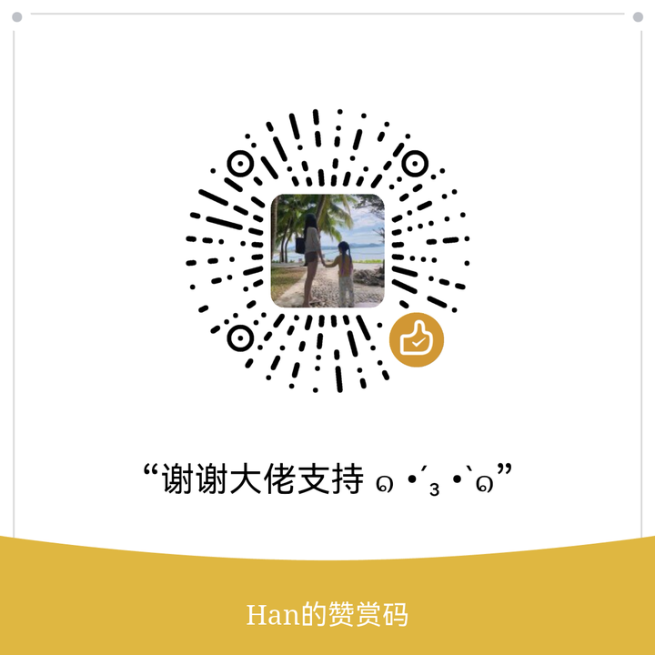

<div align="center">


# token-pilot ⚡

### 所有 AI 工具的本地账单，一抬头就看见

同时用 Claude Code / Codex / Kimi Code 跑国产模型的人，终于能答上「这个月给 AI 烧了多少钱」——只读本地日志，数据不出本机。

[](LICENSE)
[](#-状态栏应用)
[](tests/)
[](#-数据准确性)

[快速开始](#-快速开始) · [状态栏应用](#-状态栏应用) · [数据准确性](#-数据准确性) · [什么时候别用它](#-什么时候别用它) · [TODO](#-todo-list) · [English](README-en.md) · [llms.txt](llms.txt)

</div>

---


> 状态栏常驻 `⚡ ¥今日 · 预算%`。左键弹面板，「打开完整看板」看全部。我的真实 10 月：**810M tokens · ¥2,546 · 12,685 次调用**（[怎么算的](#-数据准确性)）。

> ⚠️ **注意**：npm 上的 \`token-pilot\` 是别人的同名包（MCP 代码导航工具，会往 Claude Code 写 hooks）。**我们的包叫 \`@anthonyhan/token-pilot\`**，别装错：

## 🚀 快速开始

**For Humans：**

```bash
npm install -g @anthonyhan/token-pilot
token-pilot month     # 本月账单 + 月底预测 + 打转检测 + 省钱建议
```

**For AI Agents：**（把这句粘贴给你的 Agent）

> 帮我安装 token-pilot：`npm install -g @anthonyhan/token-pilot`，然后跑 `token-pilot month` 告诉我这个月 AI 花了多少钱、哪里在浪费。

### 状态栏应用

[Releases](../../releases) 下载 `.dmg`（macOS Apple Silicon）/ `.msi`（Windows x64）。安装启动后**只在状态栏显示一个闪电图标**——无 Dock 图标、无启动窗口；左键弹面板，右键出菜单。

> 未签名：macOS 首次打开需右键 → 打开；Windows SmartScreen 选「仍要运行」。

**macOS 首次打开如果报「已损坏，无法打开」**：这是未签名应用 + Gatekeeper 隔离的误伤，跑一次即可永久解决：

```bash
xattr -dr com.apple.quarantine /Applications/token-pilot.app
```

> 长期解：Apple 开发者签名+公证（$99/年）在 TODO 里，有赞助再开。
自己构建：`cd menubar && npm install && npx tauri build`

## ✨ 它能做什么

| 场景 | 你说 | 它做 |
|---|---|---|
| 看账单 | `token-pilot month` | 按宿主/按模型双维度月账单 + 月底预测 |
| 怕超支 | 设个月度预算 | 进度条 + 超支系统通知 + 托盘常驻 `¥今日 · 预算%` |
| Agent 打转 | 不用说话 | 自动揪出「单会话 ≥30 次调用」的死循环，算出浪费金额 |
| 想省钱 | 看「省钱建议」卡 | 贵模型干轻活 → 迁移建议+每月省多少；低缓存命中 → 优化空间；本月缓存帮你省了多少 |
| 上下文太长 | 自动提醒 / 点徽标 | 会话超 100K 上下文标记「该压缩」，可写 Claude Code autoCompact / 一键装 RTK 输出压缩层 |
| 核对价格 | `token-pilot prices` | 每个在用模型的单价来源（目录价/人工覆写/自动补价待核对） |
| 谁在烧 | 看「宿主/模型/项目榜」 | 哪个工具、哪个模型、哪个项目花最多，一目了然 |
| 国产模型 | 不用配置 | DeepSeek/GLM/Kimi/Qwen 走宿主日志 model 字段自动归一 |

**兼容你的工具链：** Claude Code ✅ · Codex ✅ · Kimi Code ✅ · OpenCode ✅（全量 token）· DeepSeek/GLM/Kimi/Qwen/MiniMax/混元/MiMo/LongCat/Doubao ✅（模型归一）· 其余 12 款仅检测 · 桌面订阅端记固定月费

## 📈 数据准确性

账单工具不准就是误导。所以准确性**可验证**：

```bash
python3 scripts/reconcile.py month    # 第三方视角独立重算原始日志，与 CLI 逐项对账
python3 scripts/verify-dashboard.py   # 看板 36 项算法不变量校验
npm test                              # 40 个单元测试（定价/采集口径/聚合/注入）
```

实测修过的口径坑（2026-10-21，本机 4787 个日志文件）：

| 坑 | 影响 | 修复 |
|---|---|---|
| Claude 流式快照重复行 | 某会话 169 行 usage 实为 79 次调用 | 按 `message.id` 去重取最大 |
| Codex `input` 含 `cached` 子集 | 缓存被按全价+缓存价计两次 | 拆分 `input − cached` |
| Kimi `inputOther` 才是新输入 | 同上 | 只认 `usage.record` 且不并入缓存 |

## 📊 凭什么信我

- 我自己的 AI 账单就是它管的：本月 **¥2,546 / 810M tokens**（2026-10-21，上方截图即本机实时数据）
- 36 项看板算法不变量 + 22 个单测 + 独立对账脚本，全部开箱可跑
- 诚实披露速率口径：日志按「调用完成时刻」记账，生成中的调用完成前不计入（看板内有注明）

## ⚠️ 什么时候别用它

- **你想管的工具不写本地用量日志**（Antigravity / Copilot / Cursor 等 12 款）——只能检测到装没装，读不到 token
- **桌面订阅 App**（Kimi.app / ChatGPT.app）——不按 token 计费，只能登记固定月费
- **想拦在请求前面节流**——它是事后分析，不拦截请求（拦截需要代理层，在 Roadmap）

## 💰 支持这个项目

token-pilot 免费且 MIT。如果它帮你省下了 AI 账单，可以请我喝杯咖啡：

| 支付宝 | 微信 |
|---|---|
|  |  |

也想出现在这里？→ [bmomhan@gmail.com](mailto:bmomhan@gmail.com)（赞助位招租）

⭐ Star 本仓库 = 告诉我你在用哪个宿主——下一个 adapter 优先做 Star 用户提名最多的那个。

## 🙋 关于我

一个人 + 几个 AI Agent 在做产品实验（西安远程）。token-pilot 是我自己每天真在用的工具——它先抓出了我 kimi-code 里一个打了 120 次调用的打转会话，又告诉我这个月缓存帮我省了 ¥3,048。

**保持联系：** [X @AnthonyHan_](https://x.com/AnthonyHan_) · [bmomhan@gmail.com](mailto:bmomhan@gmail.com)

## 📝 更新日志

- **2026-10-21** v0.1.0：首版 → CLI 账单 + 本地看板 + macOS/Windows 状态栏应用，三形态一次给齐

## ✅ TODO LIST

**采集覆盖**
- [x] OpenCode adapter（SQLite）
- [x] Qoder adapter（仅会话数，model 全为 auto——诚实标注）
- [x] pi adapter
- [x] Cursor spike（结论：无 token 用量数据，ai-code-tracking 是代码追踪非用量 → 诚实归「仅检测」）
- [x] 云端用量 API：Doubao 火山（arkcli usage stats，日粒度）
- [ ] 云端用量 API：OpenAI / Kimi 开放平台（需用户配 API key）

**节流（Step 2）**
- [x] 2A 压缩潜力量化（规则引擎：陈旧输出/重复读取/超长输出 → 本月可省多少，实测 $63-95）
- [x] 2B 压缩执行第一层：自动压缩提醒 + Claude autoCompact 写入 + RTK 一键安装
- [ ] 2B 压缩执行第二层：代理网关（LiteLLM/自研，视数据再定）
- [ ] 低价模型路由（本地代理层，可选开启，默认不动你任何配置）
- [ ] 异常重试自动熔断提醒（已有检测，加主动通知策略）

**平台与工程**
- [x] macOS 状态栏应用（arm64 .app/.dmg）
- [x] Windows 核查 + 分平台图标 + CI
- [ ] Windows .msi 实机验证（Actions 产物）
- [ ] Intel Mac 包（universal2）
- [ ] 自动更新（tauri-updater）
- [ ] 签名与公证（Apple Developer $99/年，有赞助再开）

## English

**[README in English → README-en.md](README-en.md)**

*token-pilot* — local billing + budget control for all your AI coding tools. Reads local logs only (no hooks, no telemetry). CLI + local dashboard + menubar app (macOS/Windows). Chinese models (DeepSeek/GLM/Kimi…) auto-normalized via host-log `model` field.

## License

MIT © anthonyhann
